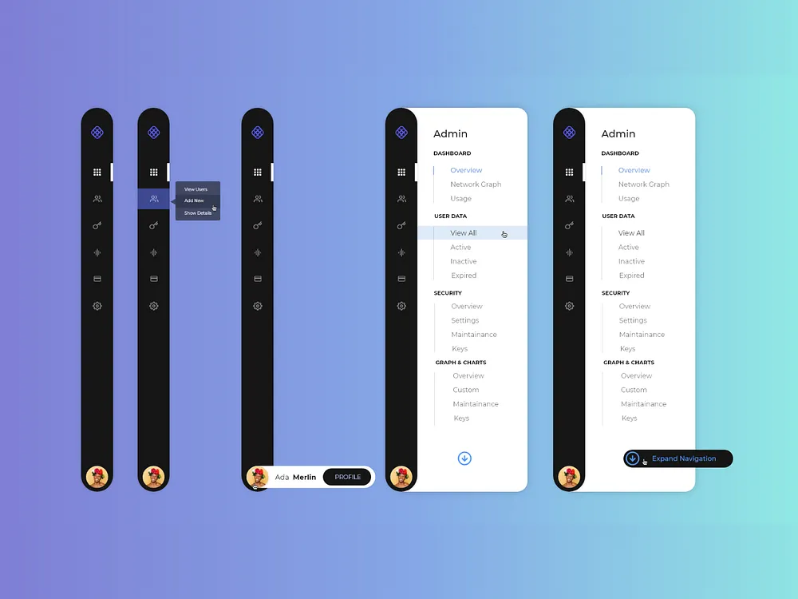

# Collapsible Dark Sidebar States on Gradient

**Discipline:** web ·  · **Design style:** Gradient & Aurora
**Tags:** sidebar, navigation, dark, collapsible, gradient, purple, mint, states

## What it is
Five black vertical sidebar states on a purple-to-mint gradient: a collapsed icon rail, one with a flyout submenu on hover, one with a profile pill expanding from the avatar, and two expanded with a white Admin panel of grouped links with an active blue item and an Expand Navigation tooltip.

## What it means
Showing each state in order documents the interaction, and the vivid gradient makes the dark rail pop.

## Techniques
- Rail that expands into a white panel
- Hover flyout submenu on an icon
- Profile pill sliding out of the avatar
- Grouped nav sections with small caps headings
- Cursor icons showing interaction

## Best for
- Navigation interaction documentation
- Admin dashboards
- Collapsible sidebars

## Vocabulary
- **Icon rail** — A narrow vertical bar of icons.
- **Flyout menu** — A submenu that appears beside an item on hover.
- **Expand state** — The widened version of a collapsed navigation.
