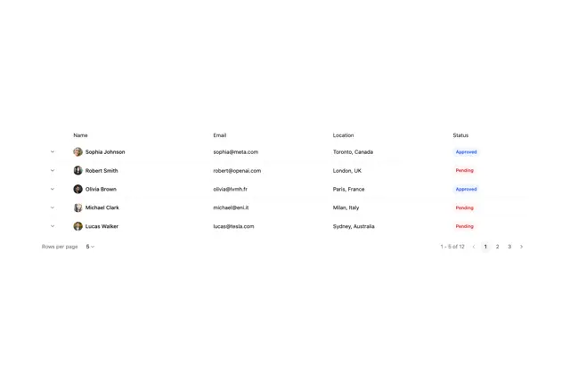

# Simple table with expand chevrons, avatar names, emails, locations, blue Approved and red Pending tags, rows-per-page and page numbers

**Discipline:** web ·  · **Design style:** Corporate & Clean-Tech
**Tags:** component, table, avatars, status-tags, pagination, white, blue, red

## What it is
A white borderless table with columns Name, Email, Location and Status, five rows with a small chevron and round avatar with name, tiny blue Approved or red Pending tags, and a footer with a rows-per-page dropdown and '1 - 5 of 12' with pagination numbers.

## What it means
Clean and compact; small tags and quiet rows keep data readable.

## Techniques
- Add expand chevrons per row.
- Use small tinted tags for status.
- Pair avatars with names.
- Put pagination in the footer.

## Best for
- Admin data tables
- User lists
- Minimal table components

## Vocabulary
- **Row expander** — A chevron that opens row details.
- **Status tag** — A tiny tinted label for state.
- **Rows per page** — A control setting how many rows show.
- **Pagination** — Numbered controls for pages of results.
