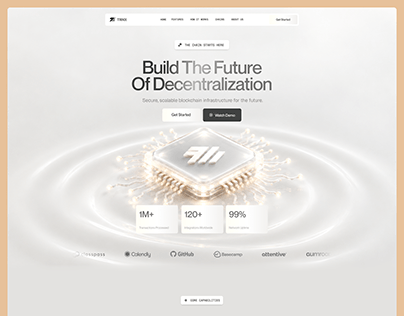

# 'Build The Future Of Decentralization' hero with a glowing 3D chip and concentric ripple rings on cream

**Discipline:** web · **Design type:** SaaS landing page · **Design style:** 3D & Surreal
**Tags:** blockchain, web3, cream, 3d-chip, ripple, hero

## What it is
A cream landing hero with a centred nav and 'Get Started' button, a bold headline 'Build The Future Of Decentralization', 'Get Started' and 'Watch Demo' buttons, a glowing gold-and-white 3D microchip at the centre of soft concentric ripple rings, three stat cards (1M+ Transactions, 120+ Validator Nodes, 99% Uptime) and partner logos below.

## What it means
Premium and calm; a warm cream palette and soft ripples make blockchain infrastructure feel trustworthy rather than cold.

## Techniques
- Centre a glowing 3D object inside soft ripple rings.
- Use a warm cream palette instead of the usual dark web3 look.
- Float stat cards directly beneath the hero object.

## Best for
- Blockchain infrastructure sites
- Web3 landing pages
- Trust-focused tech heroes

## Vocabulary
- **Ripple ring** — Concentric circles suggesting an emanating signal or wave.
- **Validator node** — A computer that verifies transactions on a blockchain network.
