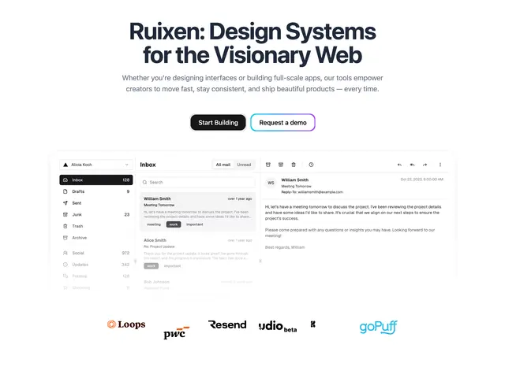

# Hero 'Ruixen: Design Systems for the Visionary Web' with a black and a violet-outlined button, an email app preview and a logo row

**Discipline:** web ·  · **Design style:** Gradient & Aurora
**Tags:** hero, dark-navy-text, white, gradient-border, app-preview, logos, saas, email-ui

## What it is
A white page with a bold navy centred headline, a grey subline, a black Start Building button and a white Request a demo button with a violet-to-teal gradient outline, a large inbox UI preview (folders, mail list with tags, message pane) fading into white at the bottom, and a row of company logos beneath.

## What it means
Clean and credible; a gradient outline makes the secondary CTA feel special without weight.

## Techniques
- Outline a secondary button in a gradient.
- Fade a product preview into the page.
- Follow with a logo row.
- Use navy for headline text.

## Best for
- Design system and SaaS heroes
- Light product-preview pages
- Gradient-outline buttons

## Vocabulary
- **Gradient outline** — A button border made from a colour gradient.
- **Fading preview** — A screenshot dissolving into the background.
- **Logo row** — A strip of customer logos.
- **Primary and secondary CTA** — A filled and an outlined action.
