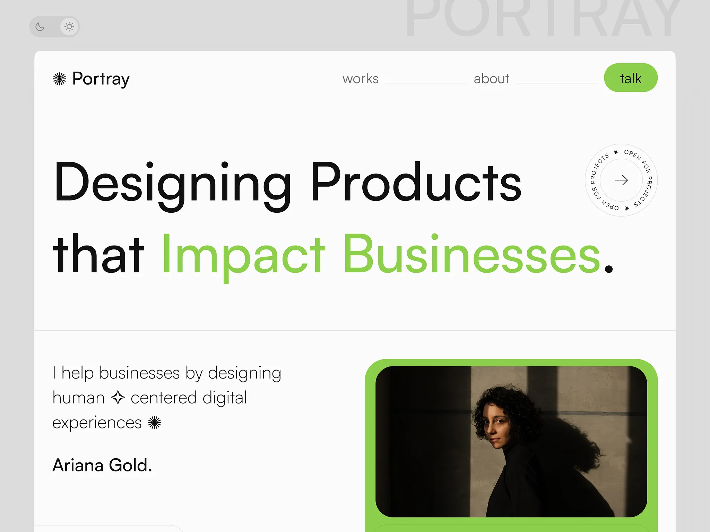

# Portfolio hero with a giant light headline, green 'Impact Businesses', circular 'open for projects' badge and a green-framed dark portrait

**Discipline:** web · **Design type:** Portfolio site
**Tags:** portfolio, light-sans, green, circular-text, badge, portrait, toggle, minimal

## What it is
A pale grey page with a theme toggle and a giant faded 'PORTRAY' at the top, a white frame containing a nav with a green 'talk' pill, a huge light black headline 'Designing Products that Impact Businesses.' with the last words in green and a circular text badge with an arrow, a paragraph with sparkle glyphs, the name 'Ariana Gold.' and a dark moody portrait inside a thick green frame.

## What it means
Confident and clean; a green keyword and frame give a minimal portfolio a fresh signature.

## Techniques
- Colour the key words of a light headline green.
- Add a circular rotating text badge.
- Frame a dark portrait with a thick coloured border.
- Use a light-dark toggle.

## Best for
- Designer and freelancer portfolios
- Light minimal heroes
- Green accent sites

## Vocabulary
- **Circular badge** — Text set on a ring around an arrow.
- **Colour frame** — A thick coloured border around a photo.
- **Theme toggle** — A switch between light and dark mode.
- **Sparkle glyph** — A star-like mark within text.
