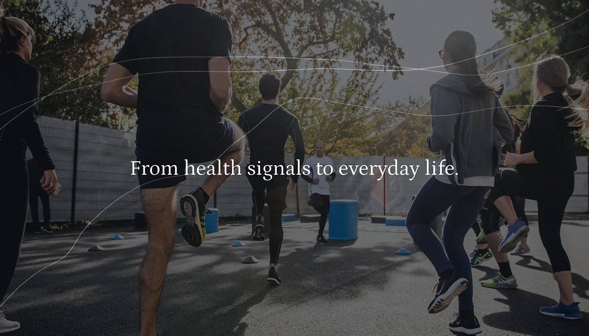

# Group-exercise photo darkened with fine wavy lines and a single serif sentence

**Discipline:** web · **Design type:** Hero section
**Tags:** hero, photography, dark-overlay, serif, wave-lines, fitness, health, minimal

## What it is
A photograph of people mid-workout outdoors from behind, darkened with an overlay. Thin white wavy lines run across the frame, and the centred sentence 'From health signals to everyday life.' is set in a light serif.

## What it means
Human and reflective; the lines suggest data flowing through everyday activity.

## Techniques
- Darken a candid action photo for legible type.
- Trace fine data-like lines over the image.
- Use a single serif sentence as the only text.
- Crop from behind so faces stay anonymous.

## Best for
- Health-data and wearable brand heroes
- Quote or mission slides over photography
- Fitness storytelling

## Vocabulary
- **Data-line overlay** — Fine curves drawn over a photo to suggest signals.
- **Dark scrim** — A dim layer over an image.
- **Single-line hero** — A hero with one sentence of text.
- **Anonymous crop** — A shot from behind that hides identity.
