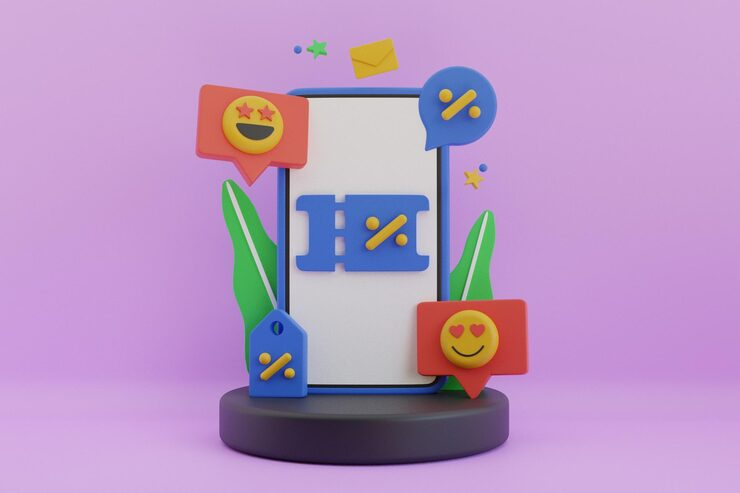

# Glossy 3D phone with a blue discount-coupon icon, surrounded by floating emoji reaction speech bubbles

**Discipline:** web · **Design type:** App store presentation · **Design style:** 3D & Surreal
**Tags:** discount, coupon, 3d-render, emoji, lilac, app-promo

## What it is
A lilac 3D scene with a glossy white phone on a dark podium displaying a blue ticket-shaped percentage-off icon, surrounded by floating red speech-bubble emoji reactions (star eyes, heart eyes, percentage tag) and green leaf shapes.

## What it means
Cheerful and shareable; emoji reaction bubbles make a discount offer feel like it's already generating excitement.

## Techniques
- Surround a hero device with floating emoji reaction bubbles.
- Render the coupon as a glossy 3D ticket-shaped icon.
- Set the whole scene on a podium for a premium product-launch feel.

## Best for
- E-commerce discount promotions
- App store feature graphics
- 3D emoji-accented marketing

## Vocabulary
- **Emoji reaction bubble** — A speech-bubble shape containing an emoji-style expression.
- **Podium scene** — A staged 3D display using a pedestal to present a hero object.
