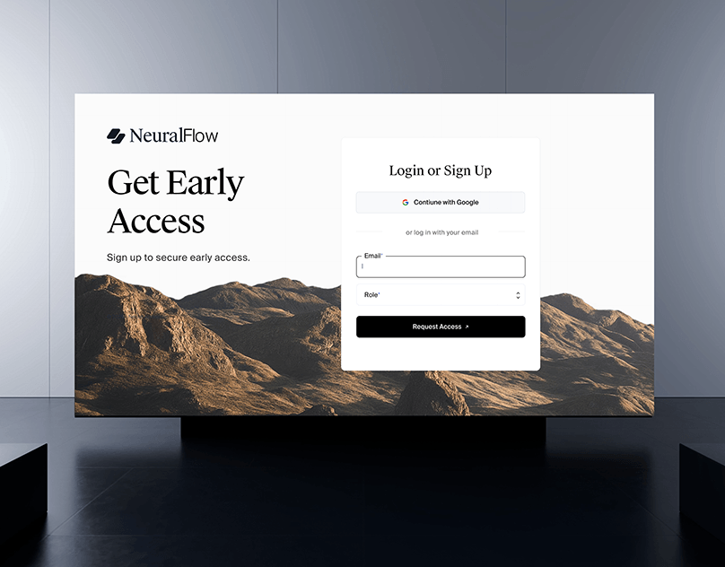

# Early-access sign-up page on a wall screen: serif headline, mountain photo and white login card, small

**Discipline:** web · **Design type:** Device mockup scene
**Tags:** sign-up, login, serif, mountains, white, card, screen-mockup, thumbnail

## What it is
A large wall screen in a dark gallery room displays a white page with a serif 'Get Early Access', a desert-mountain photo along the bottom and a white login card with Google button, email, role and a black Request Access button.

## What it means
Calm and premium; earthy mountains and serif type feel like an exclusive launch.

## Techniques
- Show the page on a large screen in a dark space.
- Use a mountain strip as a footer image.
- Float the form card over the photo edge.
- Use serif for the heading and a black button.

## Best for
- Waitlist and early-access pages
- Minimal SaaS sign-ups
- Screen-in-room mockups

## Vocabulary
- **Early-access page** — A page collecting sign-ups before launch.
- **Login card** — A white card with a form.
- **Screen-in-room** — A mockup showing a display in a space.
- **Landscape strip** — A photo band along the page bottom.
