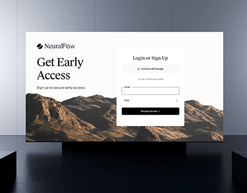

# Early-access sign-up page on a wall screen in a glossy dark gallery

**Discipline:** web · **Design type:** Device mockup scene
**Tags:** sign-up, login, serif, mountains, white, card, screen-mockup, reflective-floor

## What it is
A full-size view of the wall screen with a NeuralFlow logo, a serif 'Get Early Access', desert mountains and a floating white login form, standing on a black plinth over a reflective dark floor with blue-grey walls.

## What it means
Cinematic and calm; the dark reflective gallery makes a simple page feel valuable.

## Techniques
- Set the screen on a black plinth.
- Use a reflective floor.
- Keep the page mostly white with one photo.
- Blue-grey walls for cool ambience.

## Best for
- Waitlist page presentations
- AI startup launches
- Gallery-style mockups

## Vocabulary
- **Reflective floor** — A glossy surface mirroring the scene.
- **Plinth** — A block supporting the screen.
- **Cool ambience** — Blue-grey tones in the room.
- **Waitlist form** — A form to request access.
