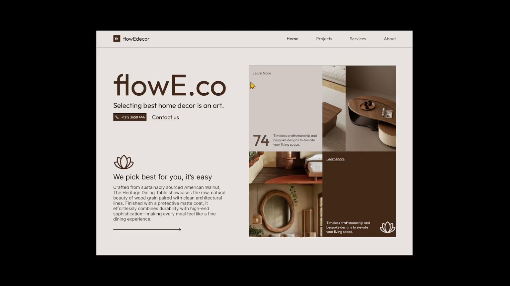

# Earthy Home Decor Bento Hero

**Discipline:** web · **Design type:** Landing page hero
**Tags:** earthy, brown, beige, bento, interior, photography, lotus, warm

## What it is
A warm greige landing hero with a large brown 'flowE.co' wordmark headline, tagline, phone CTA, lotus line icon and paragraph on the left, and a bento grid on the right mixing interior photographs with solid beige and dark brown text tiles.

## What it means
Chocolate brown on greige with natural wood photography feels calm, crafted and expensive. The bento mix of photo and color tiles adds rhythm without noise.

## Techniques
- Bento grid alternating photos and flat color tiles
- Brown-only text palette instead of black for warmth
- Big soft rounded sans wordmark as the headline
- Single-line lotus icon as a gentle brand accent
- Ample margin and left-aligned copy for a quiet reading flow

## Best for
- Interior, furniture and lifestyle brands
- Wellness and boutique services
- Craft-focused portfolios

## Vocabulary
- **Bento grid** — A modular layout of uneven rectangular tiles.
- **Tonal palette** — A palette built from close shades of one hue family.
- **Line icon** — A simple icon drawn with a thin uniform stroke.
