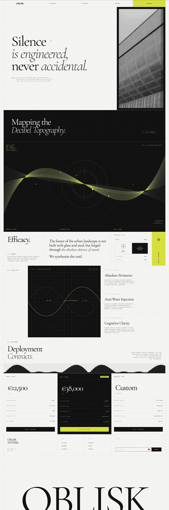

# Long site mixing large light serif italics, black telemetry panels with lime waves and monospace tags

**Discipline:** web · **Design type:** Landing page
**Tags:** editorial, serif-italic, monospace, lime, black, cream, technical, pricing

## What it is
A tall page with a cream hero 'Silence is engineered, never accidental.' in light serif and italic beside a greyscale building photo, a black 'Mapping the Decibel Topography' section with a lime wave visualisation on a grid, cream sections with monospace labels, a lime tab, diagrams of waves, a three-tier pricing table with a lime highlight and a giant serif footer name.

## What it means
Sophisticated and technical; serif italics with monospace data feel like a scientific journal.

## Techniques
- Mix light serif and italic for headings.
- Use monospace micro-labels.
- Draw data waves in lime on black.
- Highlight one pricing tier with lime.

## Best for
- Deep-tech and hardware startups
- Editorial technical sites
- Serif and monospace pairings

## Vocabulary
- **Serif-italic heading** — A heading mixing roman and italic.
- **Telemetry panel** — A dark section with technical data visuals.
- **Monospace label** — Small technical tags in monospace.
- **Wave visualisation** — Lines forming a sine-like wave.
