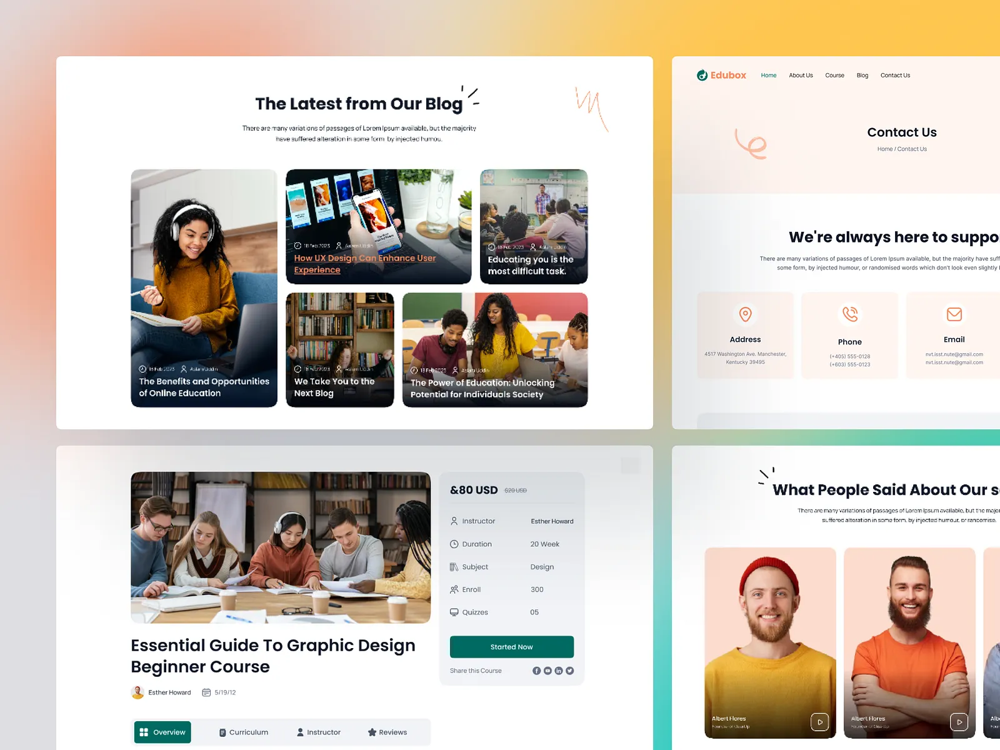

# Four Edubox sections on a coral-to-yellow gradient: photo blog grid, peach contact cards, course detail with info card, and portrait testimonials

**Discipline:** web ·  · **Design style:** Gradient & Aurora
**Tags:** education, peach, teal, gradient-backdrop, blog-grid, contact, course-page, testimonials

## What it is
A blurred coral-yellow-teal backdrop with four white or peach windows: 'The Latest from Our Blog' with a bento of dark-gradient photo cards with metadata and titles, a Contact Us page with three peach cards (address, phone, email), a course page with a large classroom photo, a title, tabs and a white info card with a teal Started Now button and share icons, and 'What People Said About Our s…' with peach portrait cards and play buttons.

## What it means
Friendly and lively; peach, teal and orange feel welcoming for learners.

## Techniques
- Use dark gradient overlays on photo bento cards.
- Tint contact cards in peach with orange line icons.
- Show course facts in a compact info card.
- Add small hand-drawn scribbles by headings.

## Best for
- Education and course platforms
- Peach and teal palettes
- Blog and testimonial sections

## Vocabulary
- **Photo bento** — A grid of photo cards with different sizes.
- **Info card** — A card listing price, instructor and duration.
- **Peach tile** — A soft peach-tinted card.
- **Scribble accent** — A small hand-drawn mark near a heading.
