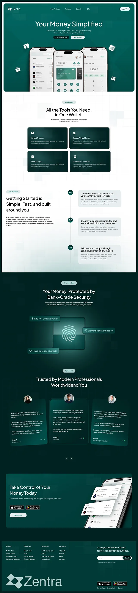

# Emerald wallet landing page moving from white to deep green with fingerprint security

**Discipline:** web · **Design type:** SaaS landing page
**Tags:** fintech, emerald, green, dark, gradient, fingerprint, cards, testimonial-cards, long-scroll

## What it is
A tall page: a bright green hero with three phones and floating icons, then white sections with dark green feature cards, numbered steps, a dark emerald security section with a glowing fingerprint scanner and labels, tilted testimonial cards, a green CTA panel, and a footer with a large logo.

## What it means
Secure, modern and wealthy; deep green feels stable while white sections keep it fresh.

## Techniques
- Transition the page from white to dark emerald to signal a security section.
- Present a glowing fingerprint scanner as a security emblem.
- Use dark green cards on light backgrounds for features.
- Tilt testimonial cards slightly for depth.
- Close with a giant logo in the footer.

## Best for
- Wallet, payments and neobank sites
- Security-focused products
- Green fintech brands

## Vocabulary
- **Security emblem** — A glowing icon (fingerprint) representing protection.
- **Tonal transition** — A page moving from light to dark sections.
- **Tilted card** — A card rotated slightly for depth.
- **Numbered steps** — A vertical list of steps in circles.
