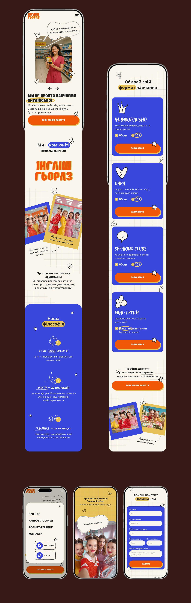

# Language school mobile site in cream, cobalt and orange with doodles and polaroids

**Discipline:** web ·  · **Design style:** Playful & Illustrated
**Tags:** mobile-web, education, cream, cobalt, orange, doodles, polaroid, grid-paper, cyrillic

## What it is
A brown board with many phone screens on a cream ruled-paper background: a hero with a smiling learner and speech bubble, a big orange display title, tilted polaroid group photos, cobalt cards for lesson formats with hand-drawn number icons and orange buttons with hard shadows, a philosophy section, menu overlay and contact form.

## What it means
Playful, youthful and human; hand-drawn doodles and photos make learning feel social and fun.

## Techniques
- Combine a cream grid-paper background with hand-drawn doodle icons.
- Use tilted polaroids with handwritten captions.
- Use bold orange buttons with hard offset shadows.
- Highlight key words in marker-like coloured pills.
- Group content into cobalt rounded cards.

## Best for
- Education and language-learning sites
- Youthful community brands
- Mobile-first service pages

## Vocabulary
- **Doodle icon** — A hand-drawn pictogram.
- **Polaroid card** — A photo with a white border and caption.
- **Offset shadow button** — A button with a solid shadow shifted to one side.
- **Marker highlight** — A coloured swipe behind a word.
