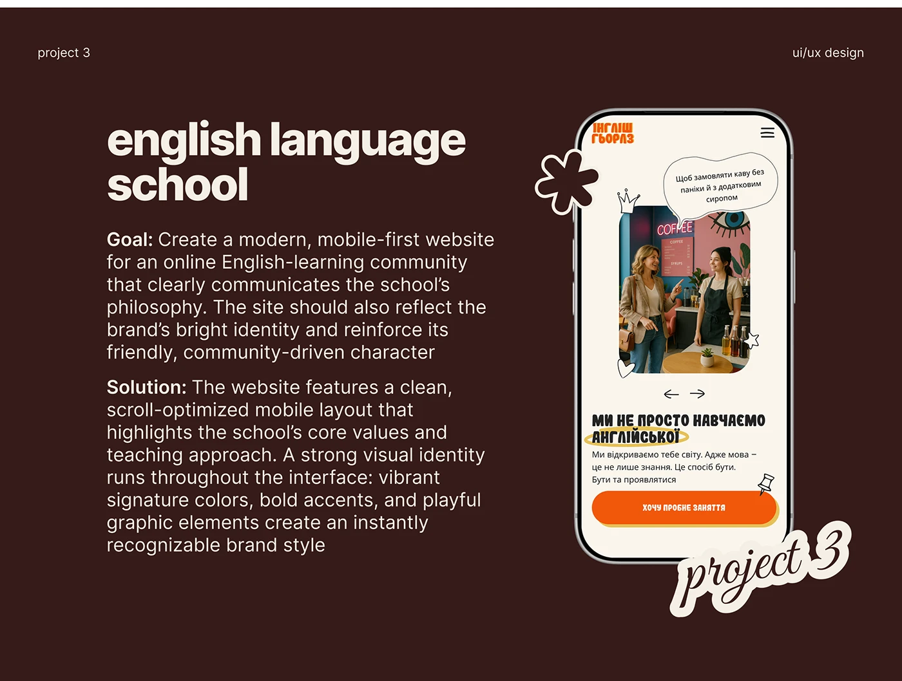

# Chocolate slide for an English-language-school site with goal and solution text and a phone with doodle stickers

**Discipline:** web · **Design type:** Case study slide
**Tags:** case-study, education, chocolate-brown, cream, phone-mockup, doodle-stickers, script, orange

## What it is
A dark brown slide with a huge cream 'english language school', Goal and Solution paragraphs with bold lead-ins, a phone showing an orange-cream mobile hero with a photo in a rounded frame, a speech bubble, a crown, pin and eye doodles, a flower outline sticker and a script 'project 3' sticker.

## What it means
Warm and playful; doodles echo the site's own style.

## Techniques
- Reuse the slide template.
- Add doodle stickers around the phone.
- Use bold lead-ins.
- Place the script project label over the corner.

## Best for
- Web project case studies
- Education branding
- Portfolio decks

## Vocabulary
- **Doodle stickers** — Hand-drawn icons overlaid on a mockup.
- **Project label** — A script label numbering the project.
- **Lead-in** — A bold opening word of a paragraph.
- **Brown template** — A recurring dark brown slide layout.
