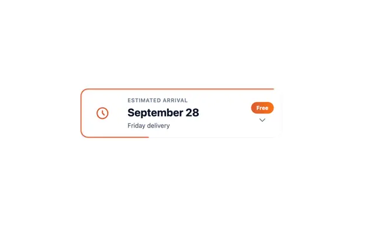

# White card 'ESTIMATED ARRIVAL September 28, Friday delivery' with an orange clock, an orange border that fills as progress and a Free pill

**Discipline:** web · **Design type:** UI components
**Tags:** component, delivery, card, orange, progress-border, white, free-tag, clock

## What it is
A white card with a rounded orange outline that runs along the top and left edges as a progress trace, an orange clock icon, a small caps label, a bold navy date, a grey line, an orange gradient 'Free' pill and a small chevron.

## What it means
Clear and reassuring; the orange outline turns a delivery estimate into a subtle progress cue.

## Techniques
- Use the card border as a progress line.
- Pair a clock icon with the date.
- Show cost in a small pill.
- Keep a single orange hue.

## Best for
- Delivery and order tracking components
- Checkout summaries
- Progress-outline cards

## Vocabulary
- **Progress border** — An outline that fills to show progress.
- **Eyebrow label** — A tiny caps label above the main text.
- **Free pill** — A capsule stating no cost.
- **Expand chevron** — An arrow indicating more details.
