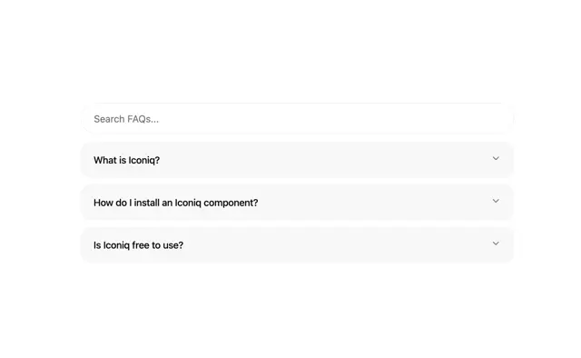

# FAQ block with a 'Search FAQs...' field and three soft grey rounded question rows with chevrons

**Discipline:** web ·  · **Design style:** Minimalist
**Tags:** component, faq, search, accordion, grey, rounded, minimal, white

## What it is
A white page with a rounded search input and three pale grey rounded rows, each with a bold-ish question (What is Iconiq?, How do I install an Iconiq component?, Is Iconiq free to use?) and a chevron at the right.

## What it means
Soft and friendly; tonal rows without borders feel gentle.

## Techniques
- Put search above the list.
- Use borderless soft grey rows.
- Add small chevrons.
- Keep questions short.

## Best for
- FAQ components
- Help centres
- Soft-fill accordions

## Vocabulary
- **Search-first FAQ** — An FAQ with a search box on top.
- **Soft fill row** — A row shown as a pale filled shape.
- **Chevron toggle** — A small arrow showing expandability.
- **Rounded input** — A field with large corner radius.
