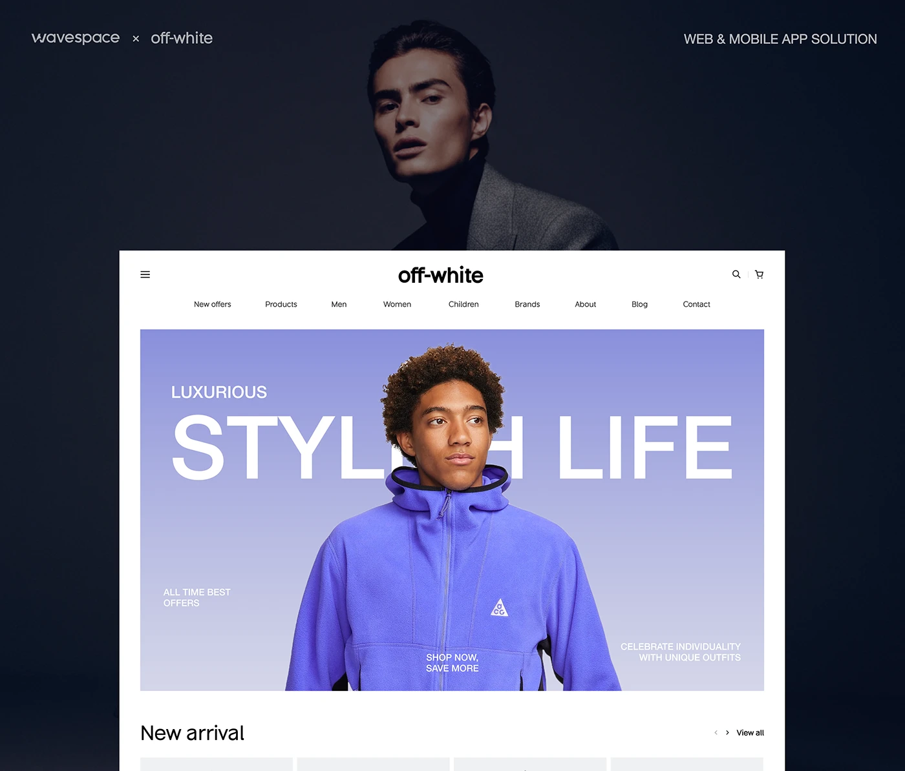

# Fashion homepage with a periwinkle hero, giant 'STYLISH LIFE' behind a model and a dark portrait header

**Discipline:** web · **Design type:** E-commerce storefront
**Tags:** fashion, periwinkle, giant-type, cutout, dark-header, navy, nav, hero

## What it is
A dark navy header with a small studio credit and a moody portrait, then a white page with centred logo and menu and a large periwinkle gradient hero where 'STYLISH LIFE' in giant white caps sits behind a model in a violet fleece, with small corner captions and a New arrival row starting below.

## What it means
Sleek and youthful; type behind the model creates depth.

## Techniques
- Place giant type behind a cutout model.
- Use a gradient hero with small captions in corners.
- Keep a plain white centred nav.
- Colour the product to match the gradient.

## Best for
- Fashion homepages
- Model-led heroes
- Periwinkle brands

## Vocabulary
- **Type-behind hero** — Giant text placed behind a person.
- **Caption corners** — Small labels in hero corners.
- **Centred nav** — A logo and menu centred at the top.
- **Colour matching** — Clothing matching the hero gradient.
