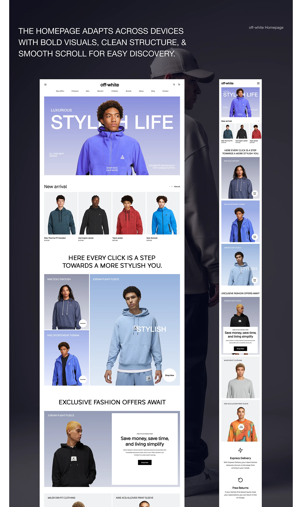

# Fashion homepage with periwinkle gradient hero, product rows and statement headlines

**Discipline:** web ·  · **Design style:** Gradient & Aurora
**Tags:** e-commerce, fashion, homepage, periwinkle, gradient-photos, uppercase-headings, mobile, dark-backdrop

## What it is
A dark backdrop with a large uppercase intro statement and a long white homepage beside a mobile version. The hero has huge white 'STYLISH LIFE' letters behind a model in a periwinkle fleece on a lavender gradient; below are a new arrivals row, an uppercase mid-page statement, a mosaic of tinted model photos with Shop Now circles, and a split offer block.

## What it means
Crisp and youthful; each model sits on a gradient that ties to one blue-violet palette.

## Techniques
- Put a giant headline behind a cutout model on a gradient.
- Give each product photo a different tint from the same blue family.
- Use round white Shop Now buttons on the images.
- Break the page with centred uppercase statements.

## Best for
- Fashion and streetwear homepages
- Retail with strong model photography
- Responsive layout presentations

## Vocabulary
- **Behind-subject headline** — Large text placed behind a cutout person.
- **Tinted photo mosaic** — A grid of photos coloured from one palette.
- **Shop-now dot** — A small circular button on an image.
- **Uppercase statement** — A centred all-caps sentence acting as a divider.
