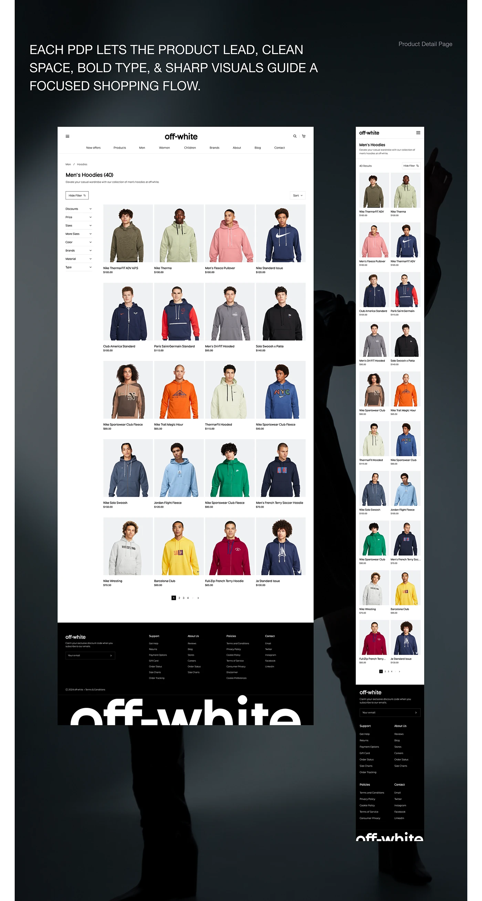

# Hoodie listing pages with filter column, 4-up grid and cropped footer wordmark over a dark silhouette

**Discipline:** web ·  · **Design style:** Dark & Neon
**Tags:** e-commerce, plp, filters, grid, dark-backdrop, mobile, giant-footer-wordmark, fashion

## What it is
A dark gradient board with an uppercase intro sentence and two white pages: a desktop listing with a collapsible filter column, a four-column grid of models in hoodies with names and prices, pagination, and black footer with a cropped giant wordmark; and a two-column mobile version.

## What it means
Orderly and dependable; even spacing and consistent photography make 40 items scannable.

## Techniques
- Use identical model photo cropping across the grid.
- Keep a collapsible filter column at left.
- Cut the footer wordmark by the edge.
- Show mobile as two columns.

## Best for
- Apparel listing pages
- Design-system presentations
- Large catalogue layouts

## Vocabulary
- **Product grid** — Evenly spaced product cards in columns.
- **Filter column** — A side list of collapsible filters.
- **Pagination** — Numbered controls for pages of results.
- **Consistent crop** — Uniform framing across images.
