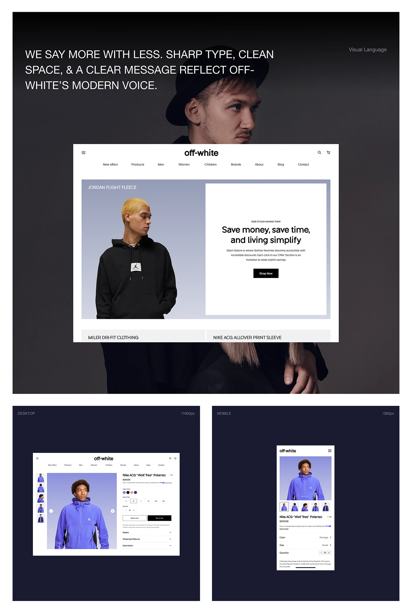

# Fashion store design language shown on a moody portrait with desktop and mobile

**Discipline:** web ·  · **Design style:** Photographic & Cinematic
**Tags:** e-commerce, fashion, dark-navy, photo-backdrop, product-page, desktop-mobile, minimal

## What it is
A board with a large dark portrait and a floating white desktop store UI (centred logo, nav row, split hero with a black hoodie and a plain white text panel). Below are two navy panels showing a product detail page in desktop and mobile with a violet fleece.

## What it means
Refined and confident; plain white UI stays neutral so product colour and portraits carry the drama.

## Techniques
- Float a white UI over a dark editorial portrait.
- Use a split hero with a product photo on one side and a text panel on the other.
- Let a single vivid product colour (violet) be the only saturated element.
- Present breakpoints as separate framed panels with size labels.

## Best for
- Fashion and streetwear e-commerce
- Design-language presentations
- Responsive design showcases

## Vocabulary
- **Split hero** — A hero divided into an image and a text panel.
- **Breakpoint panel** — A frame showing a specific screen width.
- **Floating UI** — An interface mockup hovering over a photograph.
- **Neutral shell** — A plain white interface that lets content stand out.
