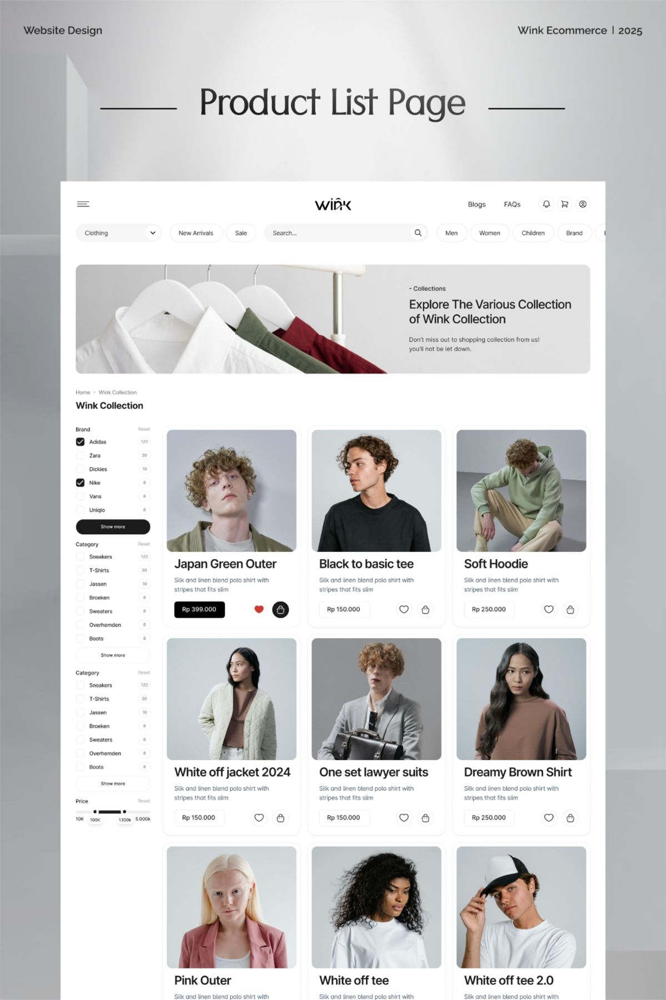

# Product list page with hanger photo banner, filter sidebar and 3-column model grid

**Discipline:** web ·  · **Design style:** Minimalist
**Tags:** e-commerce, plp, grey, filters, checkboxes, price-slider, model-photos, pill-nav

## What it is
A grey studio backdrop with a centred serif title 'Product List Page' and a white page beneath: pill filters and search, a banner of shirts on hangers, a sidebar of checkbox filters and a price slider, and a 3-column grid of studio model cards with names, price tags and heart and bag icons.

## What it means
Clean and fashionable; consistent grey studio photos make a grid cohesive.

## Techniques
- Use identical grey backdrops in every photo.
- Show filters as checkbox lists with counts.
- Place price in a bordered tag with icon buttons.
- Add a lifestyle banner above the grid.

## Best for
- Fashion PLP design
- Filtered catalogue pages
- Neutral e-commerce

## Vocabulary
- **Filter sidebar** — A column of checkbox filters.
- **Price slider** — A dual-handle range control.
- **Product card** — A card with photo, name, price and actions.
- **Studio backdrop** — A plain grey photo background.
