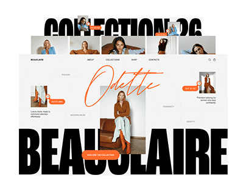

# Fashion site shown between giant black grotesque caps with an orange script signature

**Discipline:** web ·  · **Design style:** Editorial
**Tags:** fashion, cover, black-and-white, orange, script, giant-type, photo-strip, collage

## What it is
A white cover where a fashion brand website sits between two huge cropped black words, 'COLLECTION 26' above and 'BEAUCLAIRE' below. A strip of model photos runs across the top, an orange script name 'Odette' is signed over the hero, and small orange pill buttons and tags dot the layout.

## What it means
Bold and editorial; monumental type and a hand signature make a store feel like a magazine.

## Techniques
- Sandwich a UI between crop-bled giant heavy caps.
- Sign a script name over the hero photo.
- Use a single orange for buttons and tags.
- Line photos in a strip above the page.

## Best for
- Fashion and lookbook sites
- Project covers with type drama
- Black, white and one-accent brands

## Vocabulary
- **Type sandwich** — Giant words above and below an image or UI.
- **Script signature** — Handwritten lettering laid over a photo.
- **Photo strip** — A row of small images along an edge.
- **Accent pill** — A small button in the single accent colour.
