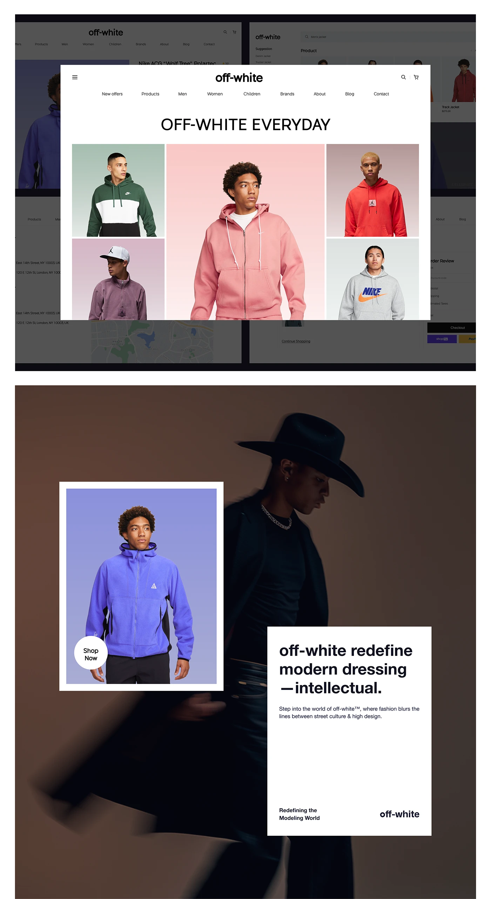

# Store overview: a white 'OFF-WHITE EVERYDAY' page over dimmed screens, and an editorial poster with a hat portrait, product frame and white text card

**Discipline:** web · **Design type:** E-commerce storefront
**Tags:** e-commerce, fashion, white-modal, pastel-photos, editorial, brown, text-card, shop-now

## What it is
A top panel shows a bright white desktop page overlaying dimmed pages, with a centred logo and nav, an uppercase title and a mosaic of models in hoodies on pastel backdrops (green, pink, red, mauve, grey). Below is a brown editorial poster of a man in a black cowboy hat with a white-framed product photo of a violet fleece with a Shop Now disc and a white text card 'off-white redefine modern dressing —intellectual.'

## What it means
Confident and editorial; the pastel product mosaic contrasts with a moody brand poster.

## Techniques
- Lift one page above dimmed screens.
- Give each product its own pastel backdrop.
- Pair a poster with a framed product photo.
- Use a white text card at the edge.

## Best for
- Fashion store overviews
- Editorial brand posters
- Pastel product mosaics

## Vocabulary
- **Lifted page** — One screen brightened above dimmed ones.
- **Pastel mosaic** — A collage of photos on different soft backdrops.
- **Framed product photo** — A product image inside a white border.
- **Text card** — A white block holding a short statement.
