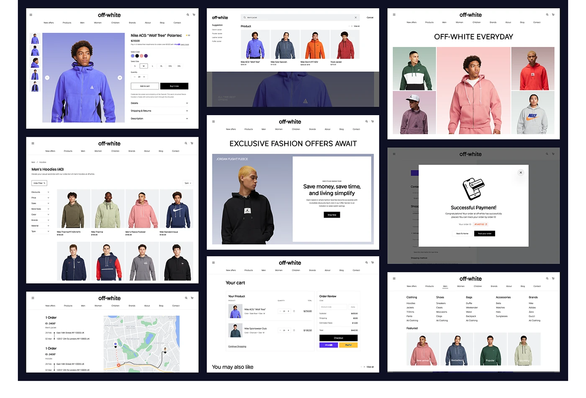

# Board of nine fashion-store screens: product page, search, everyday grid, listing, offer, success modal, cart, orders map and mega menu

**Discipline:** web ·  · **Design style:** Geometric & Bauhaus
**Tags:** e-commerce, fashion, navy, white-ui, overview, flow, product-page, mega-menu

## What it is
A dark navy board with nine white desktop screens for one store: a product detail with thumbnails, a search overlay, an 'Off-white everyday' colour-tinted photo mosaic, a men's hoodies listing with filters, an offers hero, a payment success modal, a cart with express buttons, an order tracking map and a mega menu with featured photos.

## What it means
Thorough and tidy; showing every state together proves a full system.

## Techniques
- Tile screens in a grid on a dark board.
- Tint model photos in different pastel backgrounds.
- Show modal and map states.
- Keep the UI black and white.

## Best for
- E-commerce design overviews
- Fashion store flows
- Full state coverage boards

## Vocabulary
- **Flow overview** — A board showing many screens of one flow.
- **Tinted photo mosaic** — A collage of photos on different pastel backdrops.
- **Mega menu** — A wide dropdown with many links and images.
- **Order map** — A tracking map beside an order timeline.
