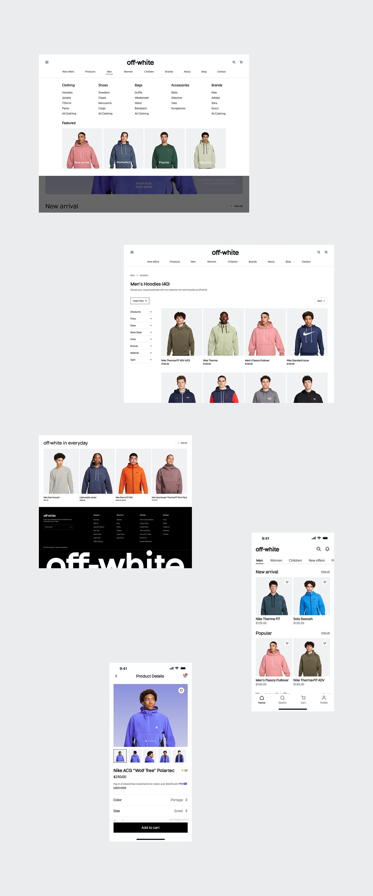

# Scattered board of fashion mega-menu, listing, footer and mobile screens

**Discipline:** web · **Design type:** E-commerce storefront
**Tags:** e-commerce, fashion, mega-menu, plp, mobile, grey-board, white-ui, footer-wordmark

## What it is
A pale grey board with several white UI fragments at staggered positions: a mega menu with category columns and photo tiles, a hoodie product listing with filters, a black footer with a cropped giant wordmark, and two mobile screens (home and product detail).

## What it means
Orderly and neutral; scattering fragments shows the breadth of a design system without one long page.

## Techniques
- Scatter screens across a neutral board rather than aligning them.
- Use a mega menu with a featured photo row.
- Label photo tiles with small white text on the image.
- Close with a black footer and giant cropped brand name.

## Best for
- Design-language overviews
- Fashion and retail systems
- Component showcases

## Vocabulary
- **Mega menu** — A large dropdown that shows many categories and images.
- **Scatter board** — A presentation with screens placed at varied positions.
- **Filter column** — A vertical list of collapsible filters.
- **Featured row** — A row of promoted tiles in a menu.
