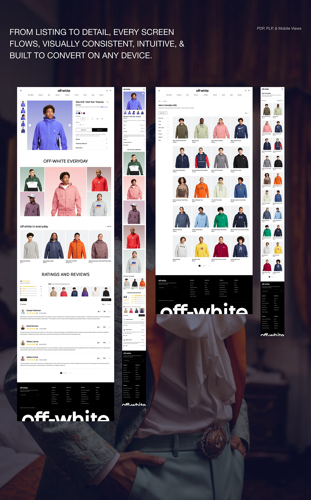

# Fashion store listing, detail and mobile views laid over a blurred editorial portrait

**Discipline:** web ·  · **Design style:** Glassmorphism
**Tags:** e-commerce, fashion, plp, pdp, black-and-white, product-grid, reviews, giant-footer-wordmark

## What it is
A board with a large uppercase statement at top and four tall screens over a dark, blurred portrait: product detail with an inline outfit gallery and reviews, a mobile version, a hoodie listing grid with filters, and a mobile listing. Each ends in a black footer with an enormous cropped 'off-white' wordmark.

## What it means
Clean and dependable; white pages and vivid clothing photos keep the focus on products.

## Techniques
- Use a neutral white shell with plain type so product colours lead.
- Present listing, detail and mobile flows side by side.
- End every page with a giant cropped wordmark on black.
- Use colourful backdrops behind each model photo.
- Place a large uppercase statement above the screens.

## Best for
- Fashion and apparel e-commerce
- Design-language and flow presentations
- Listing and product page systems

## Vocabulary
- **PLP** — Product listing page.
- **PDP** — Product detail page.
- **Cropped footer wordmark** — An oversized brand name cut off at the page bottom.
- **Flow board** — A presentation showing several connected screens.
