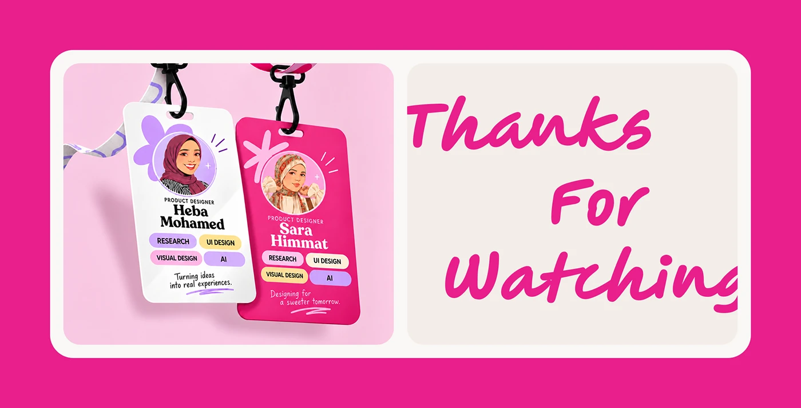

# Fati's closing slide: illustrated designer lanyard badges and a pink handwritten 'Thanks For Watching'

**Discipline:** web · **Design type:** Case study closing slide · **Design style:** Playful & Illustrated
**Tags:** closing-slide, badges, lanyard, pink, handwritten, credits

## What it is
A hot pink frame holding two panels: a photo of two ID badges on lanyards (white and pink) with illustrated portraits of hijab-wearing product designers, role tags and slogans, and a beige panel with a large pink handwritten 'Thanks For Watching'.

## What it means
Personal and memorable; credits as conference badges put faces to the work.

## Techniques
- Present credits as lanyard ID badges.
- Use illustrated avatars instead of photos.
- Close with a big handwritten thank-you.

## Best for
- Portfolio closing slides
- Team credits
- Case study endings

## Vocabulary
- **Credits slide** — A slide naming the people behind a project.
- **Lanyard badge** — An ID card worn on a neck strap.
