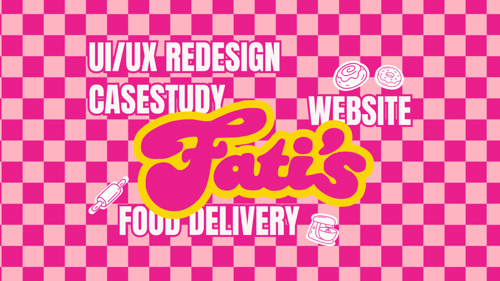

# Fati's donut website redesign cover: pink checkerboard, bubbly retro script and outlined sticker icons

**Discipline:** web · **Design type:** Project cover · **Design style:** Retro & Pixel
**Tags:** food, donuts, pink, checkerboard, retro-script, case-study-cover

## What it is
An animated cover with a hot pink and light pink checkerboard, a bubbly retro 'Fati's' script outlined in yellow, white outlined condensed words (UI/UX Redesign Casestudy, Website, Food Delivery) and white sticker-style donut, rolling pin and mixer icons.

## What it means
Sweet and loud; the diner checkerboard and retro script feel like a candy shop sign.

## Techniques
- Use a checkerboard for instant retro-diner energy.
- Outline a bubbly script in a contrasting colour.
- Add sticker-style line icons with white borders.

## Best for
- Bakery and dessert brands
- Playful case study covers
- Food delivery sites

## Vocabulary
- **Checkerboard** — A grid of alternating coloured squares.
- **Sticker outline** — A thick white border around an element.
