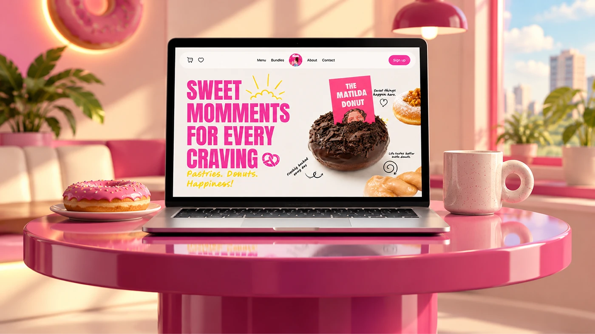

# Fati's hero on a laptop atop a glossy pink table in a rendered pink café with a donut and mug

**Discipline:** web · **Design type:** Device mockup scene · **Design style:** 3D & Surreal
**Tags:** mockup, laptop, pink, donut, cafe, 3d-render

## What it is
A rendered pink café scene: a laptop on a glossy round pink table shows the 'Sweet Moments for Every Craving' hero with a Matilda donut, beside a real pink donut on a plate and a speckled mug, with a glowing donut sign, plants and a city window behind.

## What it means
Immersive and on-brand; the whole room is dressed in the brand colour so the site feels at home.

## Techniques
- Build the mockup environment in the brand colour.
- Echo the on-screen product with a real prop.
- Use a glossy surface for reflections.

## Best for
- Hero mockups
- Food brand case studies
- Portfolio thumbnails

## Vocabulary
- **Brand environment** — A setting styled entirely in brand colours.
- **Prop echo** — A physical object repeating what's on screen.
