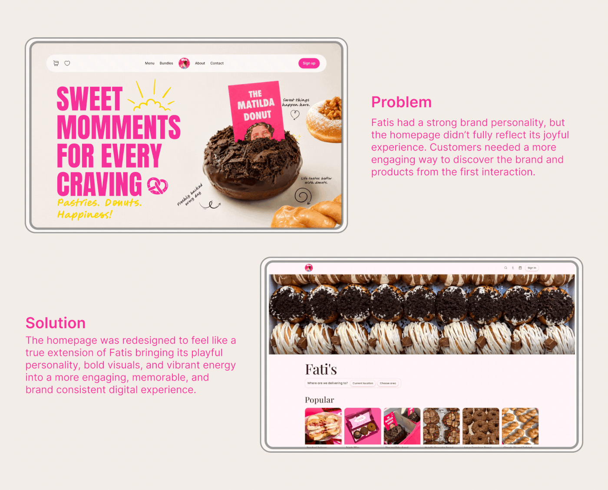

# Fati's homepage before/after: 'Problem' and 'Solution' frames with pink explanatory copy

**Discipline:** web · **Design type:** Case study slide · **Design style:** Playful & Illustrated
**Tags:** case-study, before-after, donuts, pink, homepage, animation

## What it is
An animated beige slide with two offset rounded frames: the old homepage (a plain photo banner and 'Popular' row) and the redesigned one (categories and a playful hero), each paired with a pink 'Problem' or 'Solution' heading and paragraph.

## What it means
Persuasive and honest; showing the old site next to the new makes the value of the redesign obvious.

## Techniques
- Stagger before and after frames diagonally.
- Pair each frame with a short labelled explanation.
- Keep text in the brand colour on a neutral base.

## Best for
- Redesign case studies
- Stakeholder presentations
- Portfolio storytelling

## Vocabulary
- **Before/after** — Showing an old and new version side by side.
- **Problem statement** — A short description of what needed fixing.
