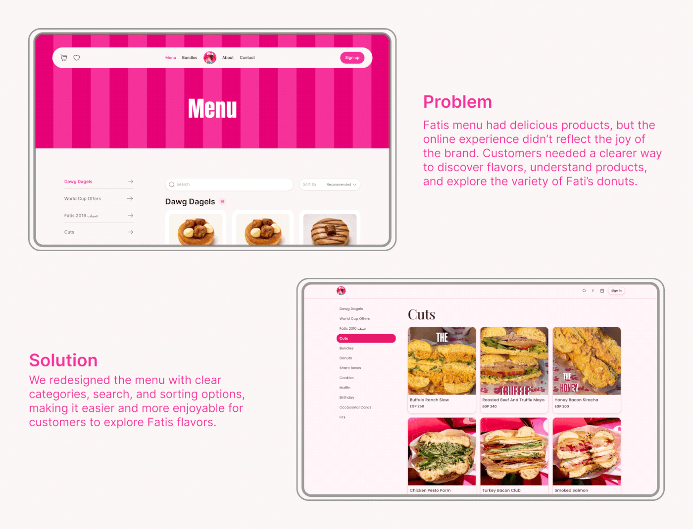

# Fati's menu before/after: striped pink 'Menu' header with sidebar categories versus the old grid

**Discipline:** web · **Design type:** Case study slide · **Design style:** Playful & Illustrated
**Tags:** case-study, before-after, menu, sidebar, pink, ecommerce

## What it is
An animated slide comparing menu pages: the redesign with a hot-pink striped 'Menu' header, left category sidebar with arrows, search and sort, and product cards, versus the old 'Cuts' page with a pink pill category list and sandwich photos, each labelled Problem or Solution.

## What it means
Clear and structured; the case for better navigation is shown, not just told.

## Techniques
- Use a striped awning header for a shopfront feel.
- Add a sidebar of categories with arrow affordances.
- Place search and sort above the grid.

## Best for
- E-commerce menu redesigns
- Food ordering sites
- UX case studies

## Vocabulary
- **Affordance** — A visual hint that something is clickable.
- **Category sidebar** — A vertical list for filtering products.
