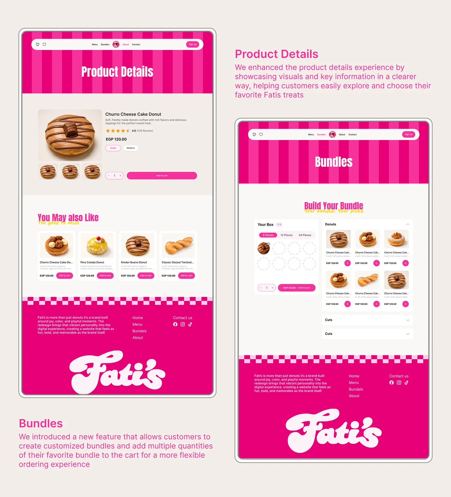

# Fati's product details page and 'Build Your Bundle' box builder with explanations

**Discipline:** web · **Design type:** Product detail page · **Design style:** Playful & Illustrated
**Tags:** food, donuts, pink, product-page, bundle-builder, ecommerce

## What it is
Two tall page frames on beige: a product page (donut photo, rating, size chips, quantity and 'Add to cart', 'You may also like' cards) and a bundle page where you pick 8/12/24 pieces and fill an empty-slot grid, each with pink explanatory text and a big 'Fati's' script footer.

## What it means
Helpful and on-brand; the empty slot grid makes building a box feel like a game.

## Techniques
- Show a box builder as empty slots that fill up.
- Offer size chips for pack quantity.
- End every page with an oversized logo footer.

## Best for
- Food e-commerce
- Custom bundle flows
- Product page redesigns

## Vocabulary
- **Bundle builder** — A tool for assembling a custom set of items.
- **Empty slot** — A placeholder showing space still to fill.
