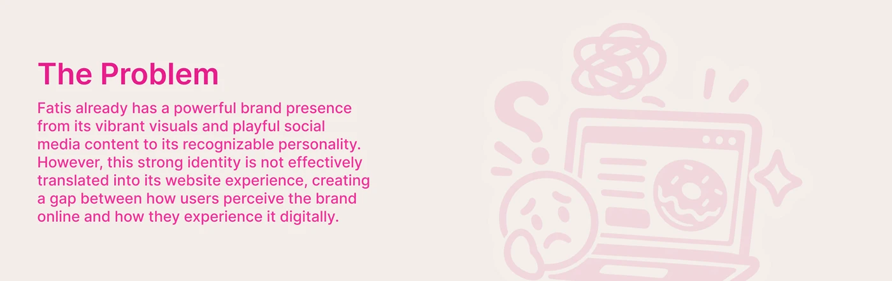

# 'The Problem' case study banner with a faded pink sketch of a stressed face and laptop

**Discipline:** web · **Design type:** Case study slide · **Design style:** Playful & Illustrated
**Tags:** case-study, problem, pink, sketch, banner, illustration

## What it is
A wide beige banner with a hot pink 'The Problem' heading and paragraph on the left and a large faded pink line sketch on the right: a worried face, a laptop showing a donut site, a question mark and a scribble.

## What it means
Honest but light; the doodle eases a serious section with humour.

## Techniques
- Put a faded line illustration behind half the banner.
- Use one brand colour for both text and art.
- Keep the section to a heading and one paragraph.

## Best for
- Case study section headers
- Problem statements
- Illustrated banners

## Vocabulary
- **Spot illustration** — A small illustration supporting text.
- **Low-opacity art** — An image faded to sit behind content.
