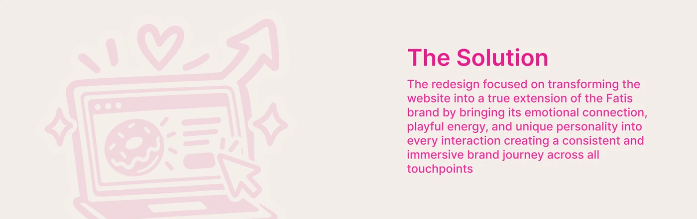

# 'The Solution' banner mirrored: faded pink laptop, heart and rising arrow sketch on the left

**Discipline:** web · **Design type:** Case study slide · **Design style:** Playful & Illustrated
**Tags:** case-study, solution, pink, sketch, banner, illustration

## What it is
A wide beige banner mirroring 'The Problem': a faded pink sketch of a laptop with a donut, a heart, sparkles, a cursor and a rising arrow on the left, and a hot pink 'The Solution' heading and paragraph on the right.

## What it means
Uplifting and paired; mirroring the layout tells the reader this answers the problem.

## Techniques
- Mirror the problem layout for the solution.
- Swap worried motifs for hearts and rising arrows.
- Keep both banners in the same palette.

## Best for
- Case study pairs
- Before/after storytelling
- Illustrated headers

## Vocabulary
- **Mirrored layout** — A layout flipped left to right to pair two ideas.
- **Visual rhyme** — Repeating a structure to link two sections.
