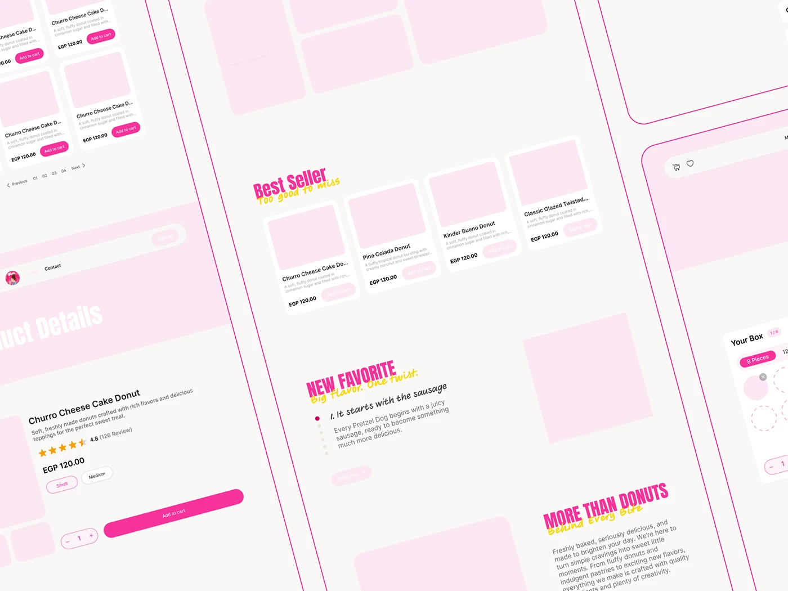

# Fati's wireframes fading into hi-fi: tilted pages with pale pink placeholder blocks and live headings

**Discipline:** web · **Design type:** Case study slide · **Design style:** Playful & Illustrated
**Tags:** wireframes, pink, tilted, case-study, ecommerce, process

## What it is
A tilted collage of long pages where pale pink placeholder rectangles stand in for images while headings ('Best Seller', 'New Favorite', 'More Than Donuts') and product details are already styled, framed by thin pink lines.

## What it means
Transparent and thoughtful; the half-finished look reveals the step between structure and polish.

## Techniques
- Show placeholders in a pale brand tint instead of grey.
- Keep headings fully styled while images are blanks.
- Tilt the whole canvas for dynamism.

## Best for
- Design process slides
- Wireframe presentations
- UX case studies

## Vocabulary
- **Wireframe** — A simplified layout showing structure without final visuals.
- **Placeholder** — A temporary block marking where content will go.
