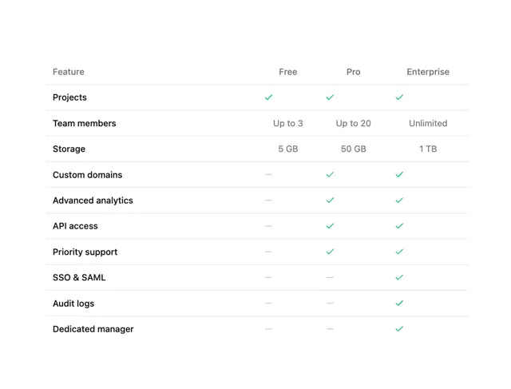

# Plan comparison table with hairline rows, green ticks, grey dashes and values like 'Up to 3' and '1 TB'

**Discipline:** web ·  · **Design style:** Minimalist
**Tags:** component, table, pricing, comparison, green-ticks, white, minimal, plans

## What it is
A white table with columns Feature, Free, Pro and Enterprise and ten rows (Projects, Team members, Storage, Custom domains, Advanced analytics, API access, Priority support, SSO & SAML, Audit logs, Dedicated manager) marked by green ticks, grey dashes or plain values such as Up to 3, 5 GB and Unlimited, divided by hairlines.

## What it means
Clear and dependable; green ticks and grey dashes make availability instantly visible.

## Techniques
- Use green ticks for included and grey dashes for excluded.
- Show limits as plain values.
- Separate rows with hairlines.
- Align plan columns evenly.

## Best for
- Pricing comparison tables
- Feature matrices
- Minimal SaaS pages

## Vocabulary
- **Feature matrix** — A table comparing features across plans.
- **Tick mark** — A check symbol showing inclusion.
- **Dash mark** — A grey dash showing exclusion.
- **Plan column** — A column representing one pricing tier.
