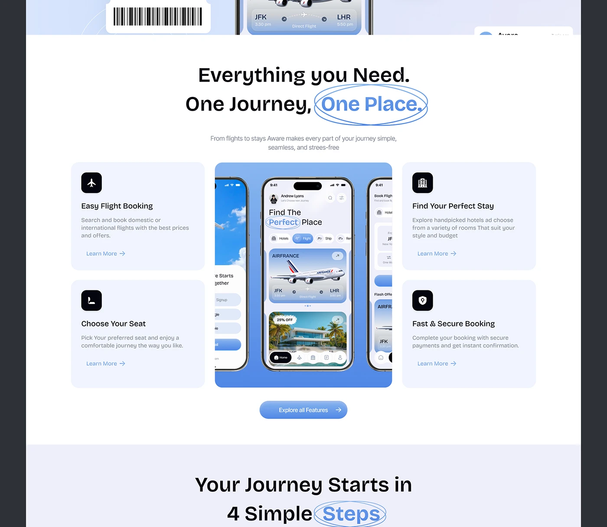

# Features Section with Circled Word and Phone Carousel

**Discipline:** web · **Design type:** Landing page sections
**Tags:** features, circled-word, cards, phones, blue, lavender, travel

## What it is
A cropped landing page section with a boarding pass tile at the top, a centred headline 'Everything you Need. One Journey, One Place.' with the last words circled by a hand-drawn ellipse, four feature cards with black icon tiles and Learn More links around a central blue tile of three phones, an Explore all Features pill and a next heading with another circled word.

## What it means
Icon cards around a centre product tile is a clear layout for feature lists, and the circled words repeat a friendly signature.

## Techniques
- Four feature cards around one central product panel
- Black rounded-square icon tiles
- Hand-drawn ellipse around key words
- Blue gradient pill CTA under the grid
- Section heading repeated with the same circling device

## Best for
- Feature sections on landing pages
- Travel and booking products
- Symmetrical feature grids

## Vocabulary
- **Centre panel** — A product visual placed between feature cards.
- **Icon tile** — A rounded square holding an icon.
- **Learn more link** — A small text link with an arrow at a card's base.
