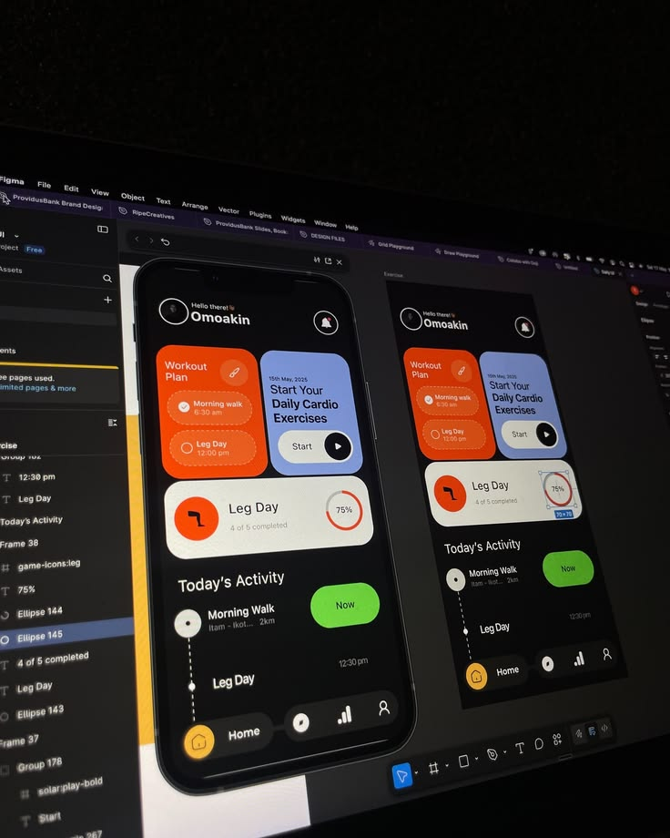

# Fitness App in Figma on a Dark Screen

**Discipline:** web · **Design type:** UI components
**Tags:** figma, photo, fitness, orange, periwinkle, dark, behind-the-scenes

## What it is
A photograph at an angle of a monitor in a dark room showing Figma with a fitness app on a black background with an orange workout plan card, a periwinkle daily cardio card, a cream Leg Day card with a progress ring, a lime Now button and a timeline, plus a duplicate frame and layer panels.

## What it means
A moody photo of the working file gives authenticity and shows the palette glowing on black.

## Techniques
- Photograph of a screen in a dark room
- Bright colour blocks on a dark UI
- Progress ring inside a cream card
- Lime pill as an action
- Layer panel shown as context

## Best for
- Behind-the-scenes design posts
- Fitness app UI showcases
- Dark UI with multiple accent cards

## Vocabulary
- **Screen photo** — A photo of a design shown on a monitor.
- **Accent card** — A card filled with a strong colour among neutrals.
- **Progress ring** — A circular indicator of completion.
