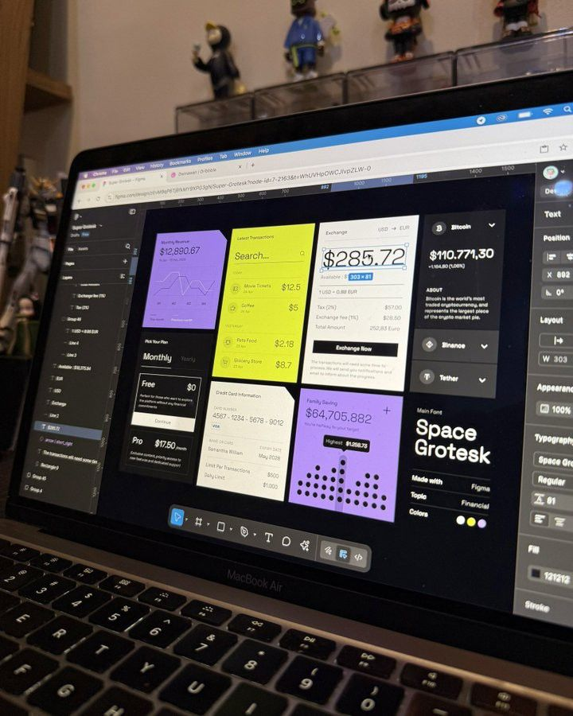

# Lime and Lilac Cards in Figma on a Laptop

**Discipline:** web · **Design type:** UI components
**Tags:** figma, laptop, photo, lime, lilac, cards, exchange, space-grotesk

## What it is
A candid photo of a laptop showing Figma with a dark UI board of interlocking cards in lilac, lime and cream: revenue chart, transactions, currency exchange, credit card info, a family saving dot chart and a Space Grotesk specimen, with toys on a shelf behind.

## What it means
A real-life shot of a work-in-progress adds authenticity, and the bright cards read clearly even at an angle.

## Techniques
- Photograph of a live design file for a behind-the-scenes feel
- Cards with angled cut corners
- Lime, lilac and cream on dark
- Big numeric hero in the exchange card
- Specimen card naming the typeface

## Best for
- Behind-the-scenes design posts
- Fintech UI kit previews
- Real-world design process shots

## Vocabulary
- **Cut-corner card** — A card with one corner sliced diagonally.
- **Behind-the-scenes shot** — A photo of the actual working file or workspace.
- **Specimen card** — A card naming and showing the typeface used.
