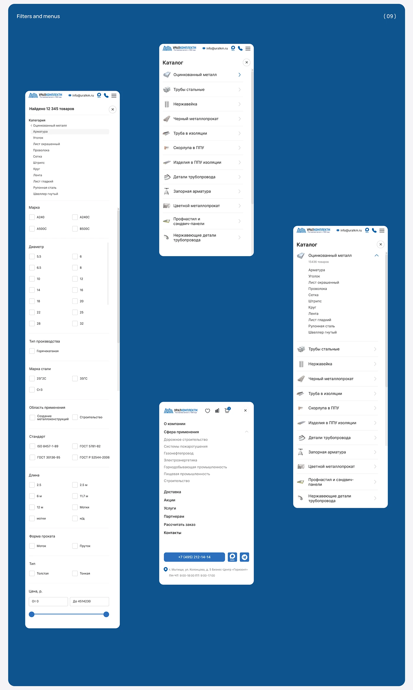

# Mobile filters, catalogue menu and nav drawer screens on a deep blue board

**Discipline:** web ·  · **Design style:** Neo-Brutalist
**Tags:** mobile-web, filters, menu, checkboxes, blue, catalog, nav-drawer, cyrillic

## What it is
A deep blue board labelled 'Filters and menus (09)' with four white phone screens: a long filter panel with category, checkbox grids, price slider; two catalogue menus with product icons and chevrons; and a nav drawer with links and a contact button.

## What it means
Orderly and functional; consistent white lists on brand blue show a complete system.

## Techniques
- Use two-column checkbox grids for filters.
- Show a catalogue list with icons and chevrons.
- Present a full drawer with contact CTA.
- Stagger screens on a solid blue board.

## Best for
- Mobile e-commerce filter design
- B2B navigation systems
- Case-study boards

## Vocabulary
- **Filter panel** — A screen of checkboxes and ranges.
- **Nav drawer** — A full menu panel opened from the burger.
- **Price slider** — A dual-handle range control.
- **Catalogue tree** — An expandable list of categories.
