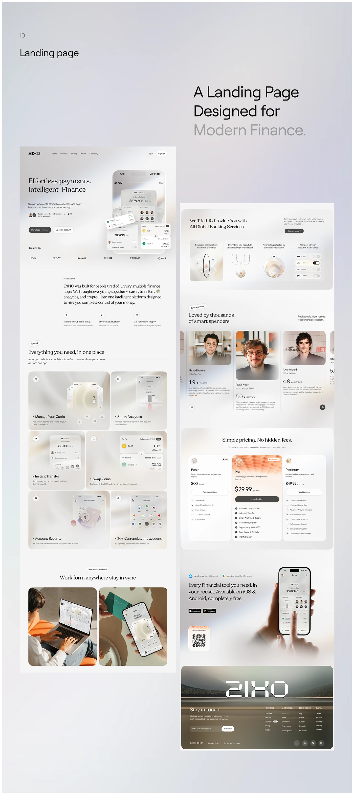

# Long pearl-grey finance site shown in two columns: hero with phone, bento features, reviews, pricing, app download and image footer

**Discipline:** web ·  · **Design style:** Glassmorphism
**Tags:** fintech, pearl, serif-headings, bento, reviews, pricing, footer-wordmark, glass

## What it is
A lilac-grey board with '10 Landing page' and a serif headline 'A Landing Page Designed for Modern Finance.' Beside it two tall pages: a hero with serif headline and pearl phones, logo strip, an about paragraph, a bento of six frosted feature tiles, work-anywhere photos; and a second column with four icon columns, reviews with portraits, three pricing plans with a highlighted middle, a hand-held app section with QR and a landscape footer with a giant wordmark.

## What it means
Calm and premium; a pearl palette with serif makes finance feel refined.

## Techniques
- Use serif headings on pearl gradients.
- Present features in frosted bento tiles.
- Highlight one pricing plan with a warm gradient.
- End with a landscape photo footer and wordmark.

## Best for
- Premium fintech landing pages
- Pearl glass web systems
- Full-page overviews

## Vocabulary
- **Frosted bento** — A grid of translucent rounded tiles.
- **Two-column overview** — Two long pages shown side by side.
- **Highlight plan** — A pricing card with a warm gradient.
- **Landscape footer** — A footer over a photograph.
