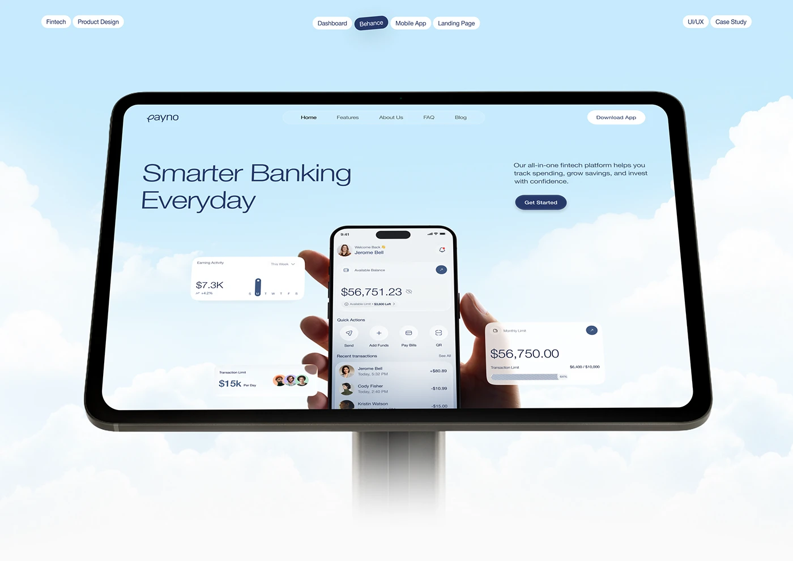

# Banking site on a huge tablet on a post amid clouds with pill tags across the top

**Discipline:** web · **Design type:** Device mockup scene
**Tags:** mockup, tablet, sky, clouds, fintech, light-blue, navy, tags

## What it is
A pale-blue sky with a giant tablet on a thin stand showing a cloud-backdrop site, with a hand holding a phone and floating stat cards. Outlined pill tags (Fintech, Dashboard, Behance, Mobile App, Landing Page, UI/UX, Case Study) sit across the top.

## What it means
Airy and clever; the tablet on a pole reads like a billboard in the sky.

## Techniques
- Place the device in a sky scene matching the site's backdrop.
- Line pill tags across the top as project metadata.
- Overlap a phone and cards on the screen.
- Stay in one light blue palette.

## Best for
- Fintech case-study covers
- Portfolio project heroes
- Sky-themed presentations

## Vocabulary
- **Billboard mockup** — A device shown like an outdoor sign.
- **Project tags** — Pills listing discipline and platform.
- **Cloud backdrop** — A sky photo used as background.
- **Nested mockup** — A phone shown inside a tablet screen.
