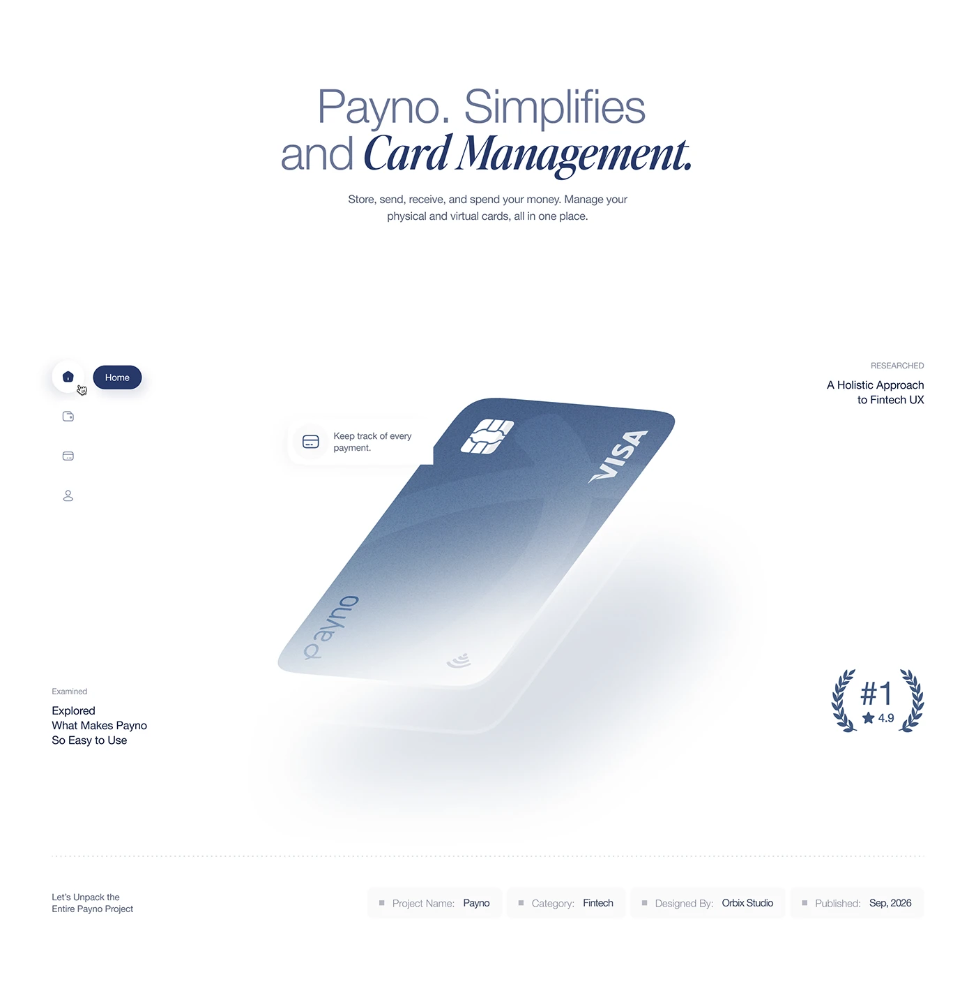

# Card management showcase with a floating tilted card, rail icons and laurel rating

**Discipline:** web ·  · **Design style:** Editorial
**Tags:** fintech, project-intro, white, navy, italic-serif, floating-card, side-nav, laurel

## What it is
A white page with a light sans and bold italic serif headline 'Payno. Simplifies and Card Management.', a large blue-to-white gradient bank card tilted and floating with a soft shadow and callout, a small left rail of icons with a Home pill, a #1 4.9 laurel and a metadata bar.

## What it means
Clean and premium; the floating card is the single hero object.

## Techniques
- Float one large object with a diffuse shadow.
- Mix light sans with bold italic serif.
- Add a small icon rail as a hint of the UI.
- Close with a metadata strip.

## Best for
- Fintech project intros
- Product showcase pages
- Minimal light layouts

## Vocabulary
- **Floating object** — A hero object suspended with a soft shadow.
- **Icon rail** — A vertical strip of icons.
- **Metadata strip** — A row of project name, category and date.
- **Callout bubble** — A small label attached to an object.
