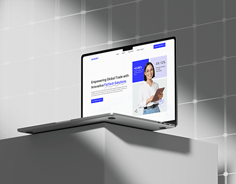

# Fintech site on a laptop perched on a white cube against a grey tiled wall with light patches

**Discipline:** web · **Design type:** Device mockup scene
**Tags:** laptop-mockup, white-plinth, grey, window-light, fintech, blue, clean, project-cover

## What it is
A laptop showing a white fintech site with a blue accent and a smiling woman sits on a stepped white block against a grey grid-tiled wall with window light and shadow.

## What it means
Clean and precise; grey stage and light patches feel like a gallery.

## Techniques
- Place the device on a plinth in a monochrome room.
- Cast window-light shapes across the wall.
- Keep the screen the only colour.
- Use a tiled wall for a subtle grid.

## Best for
- Fintech web presentations
- Minimal project covers
- Neutral gallery-style mockups

## Vocabulary
- **Gallery staging** — A mockup styled like a museum display.
- **Window light** — Shaped light patches from a window.
- **Plinth** — A block used as a stand.
- **Monochrome room** — A scene in one neutral colour.
