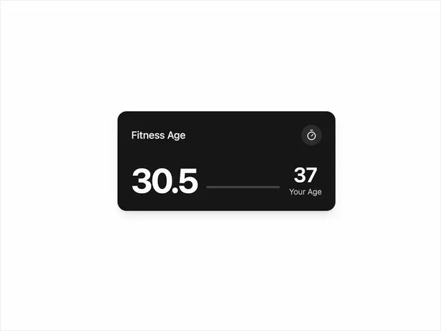

# Black rounded card 'Fitness Age' with a huge 30.5, a thin track and '37 Your Age', and a stopwatch icon button

**Discipline:** web ·  · **Design style:** Dark & Neon
**Tags:** component, stat-card, black, white, numerals, progress, health, comparison

## What it is
A black card on white with a small title 'Fitness Age' and a round dark stopwatch icon at the top, a very large white '30.5' at the left, a thin grey track in the middle and a smaller '37' with 'Your Age' at the right.

## What it means
Bold and simple; two numbers and a line tell a comparison at a glance.

## Techniques
- Set the hero number very large.
- Compare with a smaller second number.
- Link them with a thin track.
- Keep the card pure black.

## Best for
- Health and fitness stat cards
- Comparison widgets
- Minimal metric components

## Vocabulary
- **Hero number** — The main figure set very large.
- **Comparison pair** — Two numbers shown side by side.
- **Progress track** — A thin line implying a scale.
- **Icon chip** — A small round icon in a corner.
