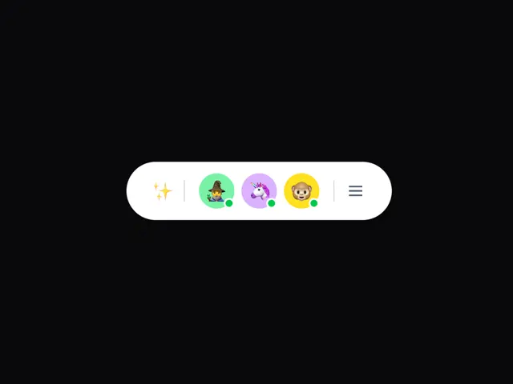

# White pill toolbar on black with a sparkle icon, three emoji avatars with green online dots and a menu icon

**Discipline:** web · **Design type:** UI components
**Tags:** component, toolbar, pill, avatars, emoji, online-status, black, white

## What it is
A black canvas with a white capsule holding a gold sparkle, a divider, three round emoji avatars (witch, unicorn, monkey) on green, lilac and yellow with small green online dots, another divider and a grey hamburger icon.

## What it means
Playful and compact; a floating pill of avatars feels like a live presence bar.

## Techniques
- Float a white pill on black.
- Use emoji avatars in pastel circles.
- Add green online dots.
- Separate groups with thin dividers.

## Best for
- Presence and collaboration bars
- Floating toolbars
- Playful avatar UI

## Vocabulary
- **Floating toolbar** — A pill of controls hovering above content.
- **Presence dot** — A small dot showing someone is online.
- **Emoji avatar** — An emoji used as a profile picture.
- **Divider tick** — A thin vertical line separating groups.
