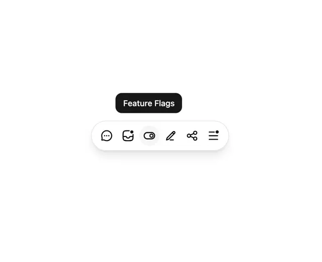

# White pill toolbar of six line icons with two notification dots and a black 'Feature Flags' tooltip above the hovered icon

**Discipline:** web · **Design type:** UI components
**Tags:** component, toolbar, tooltip, pill, icons, notification-dot, white, black

## What it is
A white page with a floating rounded pill with a soft shadow holding six black line icons (chat, inbox with a dot, toggle highlighted in a grey circle, pencil, share, menu with a dot) and a black rounded tooltip 'Feature Flags' above the hovered icon.

## What it means
Light and helpful; a tooltip names a bare icon exactly when needed.

## Techniques
- Float a pill toolbar with a soft shadow.
- Tint the hovered icon's circle.
- Show a black tooltip above it.
- Use small dots for notifications.

## Best for
- Floating toolbars and docks
- Icon tooltips
- Minimal app UI

## Vocabulary
- **Toolbar pill** — A rounded container of icon buttons.
- **Tooltip** — A small label shown on hover.
- **Notification dot** — A small filled dot on an icon.
- **Hover highlight** — A tint behind the icon under the cursor.
