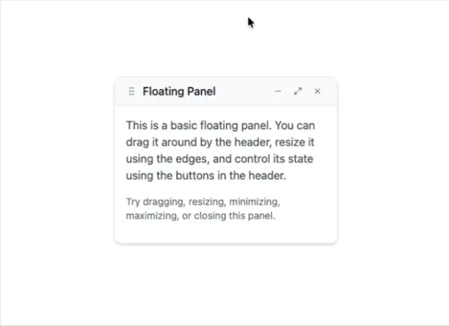

# White floating panel with a drag handle, title and three window buttons, over an instructional paragraph on a white page

**Discipline:** web · **Design type:** UI components
**Tags:** component, panel, floating, draggable, white, window-controls, cursor, minimal

## What it is
A white page with a small bordered rounded panel with a soft shadow: a header with a six-dot drag handle, the title 'Floating Panel' and minimise, maximise and close icons, and a body with a two-part paragraph explaining dragging, resizing and state buttons, with a cursor above.

## What it means
Tool-like and light; a compact window pattern for secondary content.

## Techniques
- Add a drag handle to the header.
- Include window control icons.
- Use a soft shadow for lift.
- Keep the body text short.

## Best for
- Floating tool windows
- Draggable panel components
- Utility overlays

## Vocabulary
- **Drag handle** — A dotted grip showing an element can be moved.
- **Window controls** — Minimise, maximise and close buttons.
- **Floating panel** — A movable panel above the page.
- **Resize edge** — The border used to resize a panel.
