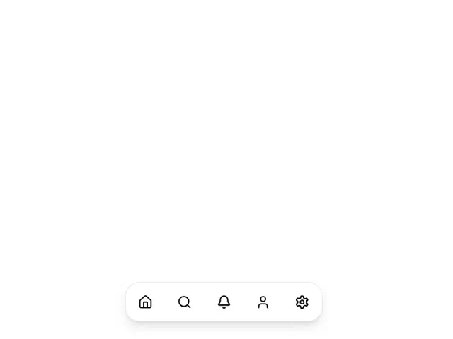

# White pill dock at the bottom with five black line icons (home, search, bell, user, settings) and a soft shadow

**Discipline:** web ·  · **Design style:** Dark & Neon
**Tags:** component, navigation, bottom-nav, pill, icons, white, shadow, floating

## What it is
A white page with a floating rounded pill near the bottom holding five black outline icons evenly spaced, lifted with a soft shadow.

## What it means
Light and reachable; a floating dock keeps navigation close to the thumb.

## Techniques
- Float a nav pill above the bottom edge.
- Use thin outline icons.
- Add a soft shadow for lift.
- Space icons evenly.

## Best for
- Mobile bottom navigation
- Floating dock components
- Minimal app UI

## Vocabulary
- **Floating dock** — A pill of icons hovering above the page.
- **Outline icon** — An icon drawn with a thin line.
- **Soft shadow** — A diffuse shadow giving lift.
- **Bottom nav** — Navigation placed at the bottom of the screen.
